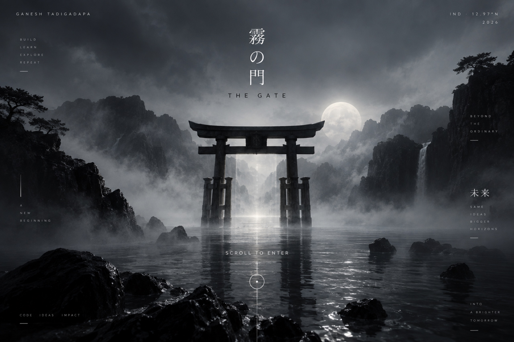

<div align="center">



# 無限 &nbsp;Ganesh Tadigadapa — Portfolio

**Developer · Designer · Creator**

*A curious mind builds a bigger tomorrow.*


</div>

---

## 👋 About

This is my personal portfolio. It is a single page, written by hand in plain HTML, CSS and JavaScript, with no framework and no build step.

The page is built like a short journey in four chapters: **Enter → Explore → Build → Observe · Connect**. You start with a loading screen, walk through a torii gate, and then scroll through my projects, my tech stack, my photographs and a way to reach me. The design is dark and quiet, with Japanese words and kanji used as small accents throughout.

## ✨ What's inside

### 🌀 Intro
- A loading screen that shows rotating Japanese words (静寂 Silence, 創造 Create, 未来 Future, 光 Light, 夢 Dream, 情熱 Passion) and ends on ようこそ *Welcome*.
- The percentage counter follows **real load signals** (fonts first, then assets), not a random timer. A failsafe opens the site even if a CDN is slow or blocked.
- You can skip it with the skip button, **Esc** or **Enter**.

### ⛩️ The gate
- A full-screen photo of a torii gate. Scrolling pushes you **into** the gate: the photo zooms, blur and fog build up, and light grows between the pillars.
- You can also click, or press **Enter** / **Space**, to walk through without scrolling.
- When you arrive, the hero section flies in from the same point.

### 🏯 Hero (Chapter 01)
- Large typographic name, a scroll dial with circular text, and a parallax 無限 (*mugen*, limitless) in the background.
- Navigation links to Projects, Stack and Photos glide smoothly to each section.

### 🧭 The journey
- A chapter counter on the side changes number (01 → 04) as you move through the page.
- Each section dims and drifts away as the next one takes over, and fades in with a soft reveal.
- A thin progress bar shows how far down the page you are.

### 🛠️ Projects (Chapter 02)
Five project cards, each with a browser-style preview and tags:

| # | Project | What it is | Built with |
|---|---------|------------|------------|
| 01 | [Splitly](https://ai-split-66al.vercel.app/) | AI expense manager — split bills using OCR and an LLM | React, Node.js, OCR, Groq, Firebase |
| 02 | [Zenkai](https://zenkai-iota.vercel.app/) | Opportunity discovery engine for students | Next.js, TypeScript, Postgres, Vercel |
| 03 | [Thread Visualizer](https://threadvisualize.netlify.app/) | Multithreading and scheduling simulator | JavaScript, HTML5, CSS3, Semaphores |
| 04 | [LPU Nexus](https://lpunexus.netlify.app/) | Campus super-app for student life | HTML5, CSS3, JavaScript, Netlify |
| 05 | [RetinaX](https://github.com/ganesh-tadigadapa/retinaX) | Explainable AI for diabetic retinopathy (code on GitHub) | Python, TensorFlow, FastAPI, React |

- A soft sheen follows your pointer across each card.
- Screenshots only appear once they have loaded, so a missing image never shows as a broken frame.

### 🧱 Tech stack (Chapter 03)
- An illustrated board with **18 technologies** set into its floor in perspective. Each tile lights up when you hover or focus it (TensorFlow is lit by default).
- On small screens the same 18 are shown as a simple grid instead.

### 📷 Photography (Chapter 04 — *Through My Lens*)
- A horizontal film strip of **7 photographs**, each with a short caption.
- Move through it with the arrow buttons, the **← / →** keys, or a vertical trackpad swipe. A counter and progress bar show where you are.

### ✉️ Connect
- A closing "Let's Build Something Great." section with links to get in touch.

### 🎨 Little touches
- 🌗 **Light / dark theme** toggle. The new theme opens as a circle from the button (where the browser supports View Transitions), and your choice is remembered.
- 🖱️ A custom two-part cursor that trails the pointer on desktop.
- 🎞️ Film grain and vignette over the whole page.
- ♿ Respects **reduced motion**: the heavy animations are turned off for people who ask their system for less motion.
- 📱 Responsive layout for phones, tablets and desktops.

## 🧰 Tech stack

- **HTML5** — one page, `index.html`
- **CSS3** — split into one file per section, plus shared variables and responsive rules
- **JavaScript (ES modules)** — one module per section, wired together in `js/main.js`
- **[Devicon](https://devicon.dev/)** (via CDN) for the technology logos
- **Google Fonts** — Inter, Cormorant Garamond and Noto Serif JP

No frameworks, no bundler, no `npm install`.

## 🚀 Run locally

The scripts are ES modules, and most browsers block modules when a page is opened straight from the file system (`file://`). So serve the folder with any small static server:

```bash
git clone https://github.com/ganesh-tadigadapa/Portfolio.git
cd Portfolio
npx serve .
```

Then open the address it prints (usually `http://localhost:3000`).

Other options that work just as well:

```bash
python3 -m http.server 8000      # then open http://localhost:8000
```

or the **Live Server** extension in VS Code (the repo's `.vscode/settings.json` sets it to port `5501`).

## 📁 Project structure

```
Portfolio/
├── index.html            # the whole site
├── css/
│   ├── variables.css     # colour tokens, dark + light theme
│   ├── main.css          # global base styles
│   ├── intro.css         # loading screen + gate
│   ├── hero.css
│   ├── navigation.css
│   ├── journey.css       # chapter transitions
│   ├── projects.css
│   ├── tech-stack.css
│   ├── photography.css
│   ├── contact.css
│   └── responsive.css    # screen sizes + reduced motion
├── js/
│   ├── main.js           # entry point, cursor, theme toggle
│   ├── animations.js     # scroll reveals, progress bar, parallax
│   ├── intro.js          # loading screen + gate
│   ├── journey.js        # chapter counter
│   ├── navigation.js     # smooth in-page links
│   ├── projects.js
│   ├── tech-stack.js
│   └── photography.js
├── assets/
│   ├── gate.jpg          # the torii gate
│   ├── stack-plate.svg   # tech stack board
│   ├── projects/         # project screenshots
│   └── lens/             # photographs
├── enter_gate3d.html     # early experiment: 3D gate doors
└── projects_core.html    # early experiment: projects section
```

## 📬 Contact

📧 [ganeshtadigadapa1@gmail.com](mailto:ganeshtadigadapa1@gmail.com)

<div align="center">

<sub><em>また、どこかで。</em> — Until next time</sub>

</div>
